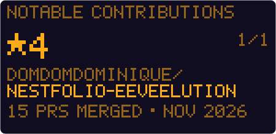
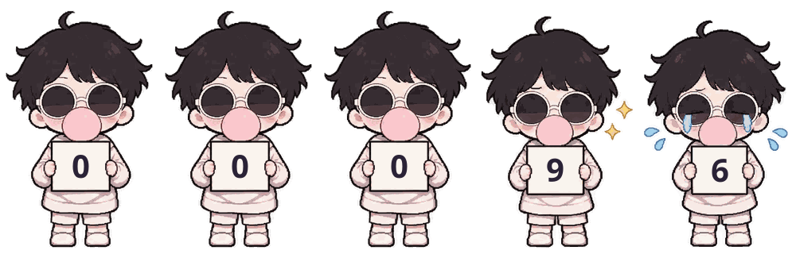

## About

I'm a Computer Science student in Singapore who likes turning ideas into small, useful and slightly different projects. I'm working on my C++ and full-stack skills, from the frontend to the backend, and I enjoy interfaces with a lofi, pixel-art feel.

> Small steps, steady commits, a new blossom every season.

## Tech

## Projects

**Digital Biz Card** is my own project; the code is private and the live card is open. **[Nestfolio-Eeveelution](https://github.com/domdomdominique/Nestfolio-Eeveelution)** is a CSIT314 group project where I contributed frontend and backend features, security hardening and acceptance tests.

## Contact

Save my contact from my digital business card.

## Garden

A sakura tree grown from my public contributions: one blossom cloud per season, oldest in the middle, newest on the outside. Refreshed nightly.

## Stats

## Visitors

